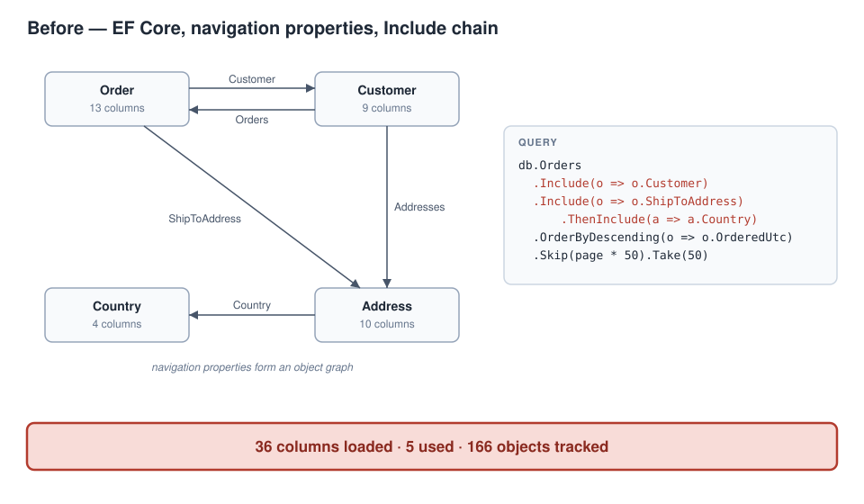
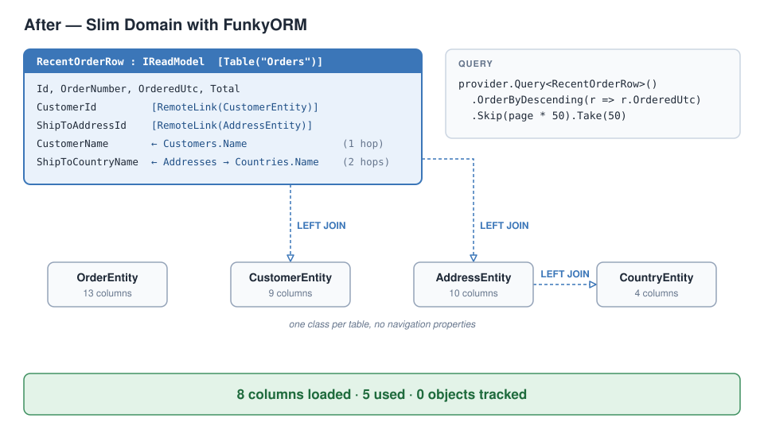

# Slim Domain

**A domain-structuring pattern for .NET: persistence contracts separated from business behavior.**

Slim Domain cuts data access down to what each operation uses, and makes that the path of least resistance
rather than an act of discipline. The canonical entity is the table and nothing more. Every read returns a
shape carrying only what the screen or operation needs. Services alone persist; nouns never save themselves.
It is a pattern, not a library and not an application architecture: it lives inside layered, vertical-slice,
clean and microservice hosts, and on top of Entity Framework Core, Dapper or a micro-ORM.

This repository is the pattern's public home. It holds three things:

| | What | For whom |
|---|---|---|
| [**The paper**](paper/) | *Slim Domain: A Domain-Structuring Pattern for .NET*, v1.0-rc1 (October 2026). The full argument, twenty-two listings, the evidence and its limits. **Open for peer review.** | Architects, reviewers, the curious |
| [**Agent guidance**](guidance/) | The paper compressed into instructions for a coding agent, ready to paste into `CLAUDE.md`, `AGENTS.md` or `copilot-instructions.md`. | Teams that build with agents |
| [**The Switchback sample**](samples/Switchback/) | A .NET 10 solution that converts one feature slice of an EF Core application to FunkyORM the Slim Domain way, and measures the difference. Clone it, press F5. | Developers; the [labs](labs/) and the video series |

## The idea in one number

**Fields loaded, compared with fields used.** The sample's "Recent orders" screen shows five fields. Here
is what three implementations of that screen cost, measured on the same data by the sample's own runner:

```
Recent orders, page 0 (50 rows)                 fields loaded   fields used   objects tracked   median ms*
--------------------------------------------------------------------------------------------------------------
1  EF Core — Include chain                                 36             5               166          2.2
2  EF Core — projection                                     5             5                 0          1.0
3  FunkyORM — read model                                    8             5                 0          0.8

Rows identical across variants: YES (sha256 e970…1100)
* this machine, warm cache, median of 20 runs after 3 warm-ups. Illustrative only.
```

Row 1 is the code most EF teams write first: it walks navigation properties and loads four tables' worth
of columns, including every customer's email and credit limit. Row 2 is the proper EF fix, a `Select`
projection, and it deserves full credit. Row 3 is the Slim Domain version: the lean query is the only query
that type can produce, so nobody has to remember the fix at the next call site.

## Before and after

**Before.** The EF model is an object graph; every edge invites an `Include`.



**After.** One plain class per table with no edges, plus one read model that declares the screen's shape,
including the path to each value from another table. The joins exist only in queries of that type.



The read model, in full:

```csharp
[Table("Orders")]
public sealed class RecentOrderRow : IReadModel
{
    public int Id { get; set; }
    public string OrderNumber { get; set; } = "";
    public DateTime OrderedUtc { get; set; }
    public decimal Total { get; set; }

    [RemoteLink(typeof(CustomerEntity))] public int CustomerId { get; set; }
    [RemoteLink(typeof(AddressEntity))]  public int? ShipToAddressId { get; set; }

    [RemoteProperty(typeof(CustomerEntity), nameof(CustomerId), nameof(CustomerEntity.Name))]
    public string CustomerName { get; set; } = "";

    [RemoteProperty(typeof(CountryEntity),
        nameof(ShipToAddressId), nameof(AddressEntity.CountryId), nameof(CountryEntity.Name))]
    public string? ShipToCountryName { get; set; }
}
```

The whole walk-through, with the SQL each version sends, is in [docs/before-after.md](docs/before-after.md).

## Quick start

You need the [.NET 10 SDK](https://dotnet.microsoft.com/download/dotnet/10.0) and SQL Server Express
LocalDB, which Visual Studio installs with its .NET workloads. Any other SQL Server works too (set
`SWITCHBACK_CONNECTION`; the [sample README](samples/Switchback/README.md) has a Docker one-liner).

```bash
git clone https://github.com/FuncularLabs/slim-domain.git
cd slim-domain/samples/Switchback
dotnet run --project src/Switchback.Demo
```

Or open `samples/Switchback/Switchback.slnx` in Visual Studio, make sure `Switchback.Demo` is the startup
project, and press F5. The first run creates the database and seeds 100,000 orders (15–30 seconds);
every run after that prints the scoreboard. Then:

```bash
dotnet run --project src/Switchback.Demo -- sql include     # the SQL each variant sends
dotnet run --project src/Switchback.Demo -- sql funky --country Canada
dotnet test                                                 # parity, SQL shape, architecture gate
```

## The five tenets

1. **Flatten to the use case.** Shape each read to the immediate need; avoid object graphs.
2. **Keep canonical entities minimal.** The persistence contract is the table and nothing more.
3. **Inherit where boundaries do not require separation.** Business objects acquire the entity shape
   directly; DTOs are reserved for genuine boundaries.
4. **Keep nouns and verbs apart.** Objects carry state and behavior; services perform persistence. An
   object never saves itself.
5. **Structure the domain; do not dictate the architecture.** The pattern coexists with whatever host
   architecture you already have.

The paper's §2 says what the pattern is and is not; the guidance's §2 turns the tenets into MUST / SHOULD /
NEVER rules with a pull-request checklist.

## Peer review

The paper is a release candidate and this is its first public showing. It has been through adversarial
review by AI reviewers (disclosed in its Appendix A) and not yet by people outside Funcular Labs.
Counter-examples, prior art we missed, and holes in the evidence are the most useful things you can send.
[paper/README.md](paper/README.md#status-release-candidate-open-for-review) says what helps most and how
to send it: [Discussions](https://github.com/FuncularLabs/slim-domain/discussions) for disagreement and
alternatives, [Issues](https://github.com/FuncularLabs/slim-domain/issues) for specific defects.

## Labs and the video series

The [labs](labs/) walk through the sample one EF gotcha at a time: the mistake, the proper EF fix, the
Slim Domain version. Lab 01, *36 columns to show 5*, is the one above. Six more are planned; each will add
a slice to the sample and a row to its scoreboard. The labs are also the outline of a FunkyORM video series.

## Versions

| Component | Version |
|---|---|
| Paper | 1.0-rc1, 2026-10-02 |
| Agent guidance | 1.0-rc1 (matches the paper) |
| Switchback sample | .NET 10 · EF Core 10.0.12 · FunkyORM ([`Funcular.Data.Orm`](https://www.nuget.org/packages/Funcular.Data.Orm)) 3.12.1 |

FunkyORM is the micro-ORM the sample uses for the Slim Domain side; it is [open source](https://github.com/FuncularLabs/Funcular.FunkyOrm)
and under active development. The pattern does not depend on it: the paper shows the same habit on EF Core
(views) and Dapper (projections).

## License

Code, labs and diagrams: [MIT](LICENSE). The paper and the guidance: [CC BY 4.0](LICENSE-DOCS.md).

## Citing

See [CITATION.cff](CITATION.cff). In prose: *Smith, P. (2026). Slim Domain: A Domain-Structuring Pattern
for .NET — Persistence Contracts Separated from Business Behavior (v1.0-rc1). Funcular Labs.*
