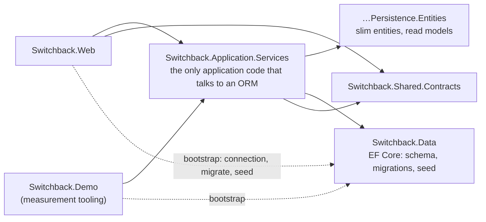

# Before and after: 36 columns to show 5

This is the story the [Switchback sample](../samples/Switchback/) tells, with the real code and the real SQL.
Everything quoted here comes from `dotnet run --project src/Switchback.Demo -- sql <variant>`; the only
edit is that the FunkyORM `SELECT` list, which the tool prints on one line, is wrapped for width.

## The screen

A "Recent orders" list, 50 rows a page, newest first. Each row shows five things:

| On screen | Comes from | Distance from the order |
|---|---|---|
| Order # | `Orders.OrderNumber` | 0 |
| Ordered | `Orders.OrderedUtc` | 0 |
| Customer | `Customers.Name` | one hop (`Orders.CustomerId`) |
| Ship to | `Countries.Name` | two hops (`Orders.ShipToAddressId` → `Addresses.CountryId`) |
| Total | `Orders.Total` | 0 |

The four tables have 36 columns between them: Orders 13, Customers 9, Addresses 10, Countries 4. About 3% of
orders have no ship-to address (gift cards), so the country can be null.

## Before: the object graph

The EF model has navigation properties, as most EF models do. Every one of them is an edge in a graph, and
every edge is an invitation to `Include`:


So the natural code walks the edges. It is readable, it returns the right rows, and it passes review
(`EfIncludeChainRecentOrdersService.cs`):

```csharp
var orders = await db.Orders
    .Include(o => o.Customer)
    .Include(o => o.ShipToAddress)
        .ThenInclude(a => a!.Country)
    .OrderByDescending(o => o.OrderedUtc)
    .ThenByDescending(o => o.Id)
    .Skip(page * pageSize)
    .Take(pageSize)
    .ToListAsync(ct);

// The screen needs five values. We loaded every column of four tables to get them.
return orders.Select(o => new RecentOrderResponse(
    o.OrderNumber, o.OrderedUtc, o.Customer.Name, o.ShipToAddress?.Country.Name, o.Total)).ToList();
```

EF Core 10 sends this. Count the outer `SELECT` list: **36 columns**, including every customer's email,
phone, credit limit and notes.

```sql
SELECT [o0].[Id], [o0].[CreatedUtc], [o0].[CustomerId], [o0].[InternalNotes], [o0].[ModifiedUtc], [o0].[OrderNumber], [o0].[OrderedUtc], [o0].[ShipToAddressId], [o0].[ShippingFee], [o0].[Status], [o0].[Subtotal], [o0].[Tax], [o0].[Total], [c].[Id], [c].[CreatedUtc], [c].[CreditLimit], [c].[Email], [c].[LoyaltyTier], [c].[ModifiedUtc], [c].[Name], [c].[Notes], [c].[Phone], [a].[Id], [a].[City], [a].[CountryId], [a].[CustomerId], [a].[Latitude], [a].[Line1], [a].[Line2], [a].[Longitude], [a].[PostalCode], [a].[Region], [c0].[Id], [c0].[CurrencyCode], [c0].[IsoCode], [c0].[Name]
FROM (
    SELECT [o].[Id], [o].[CreatedUtc], [o].[CustomerId], [o].[InternalNotes], [o].[ModifiedUtc], [o].[OrderNumber], [o].[OrderedUtc], [o].[ShipToAddressId], [o].[ShippingFee], [o].[Status], [o].[Subtotal], [o].[Tax], [o].[Total]
    FROM [Orders] AS [o]
    ORDER BY [o].[OrderedUtc] DESC, [o].[Id] DESC
    OFFSET @p ROWS FETCH NEXT @p1 ROWS ONLY
) AS [o0]
INNER JOIN [Customers] AS [c] ON [o0].[CustomerId] = [c].[Id]
LEFT JOIN [Addresses] AS [a] ON [o0].[ShipToAddressId] = [a].[Id]
LEFT JOIN [Countries] AS [c0] ON [a].[CountryId] = [c0].[Id]
ORDER BY [o0].[OrderedUtc] DESC, [o0].[Id] DESC
```

And because the query returns entity types, EF tracks every object it materialized: 50 orders, their
customers, their addresses and their countries. **166 objects** for one page.

`AsNoTracking()` brings the tracked count to zero. It does not change the 36. The columns are the cost.

## The EF fix: project

The right EF answer is a `Select` into the response type (`EfProjectionRecentOrdersService.cs`):

```csharp
return await query
    .OrderByDescending(o => o.OrderedUtc)
    .ThenByDescending(o => o.Id)
    .Skip(page * pageSize)
    .Take(pageSize)
    .Select(o => new RecentOrderResponse(
        o.OrderNumber,
        o.OrderedUtc,
        o.Customer.Name,
        o.ShipToAddress!.Country.Name,   // EF propagates null through the LEFT JOINs
        o.Total))
    .ToListAsync(ct);
```

EF writes the same joins and selects **5 columns**. A projection that returns no entity type is never
tracked, so there is nothing to add; `AsNoTracking()` would only suggest to a reader that it was needed.

```sql
SELECT [o0].[OrderNumber], [o0].[OrderedUtc], [c].[Name], [c0].[Name], [o0].[Total]
FROM (
    SELECT [o].[Id], [o].[CustomerId], [o].[OrderNumber], [o].[OrderedUtc], [o].[ShipToAddressId], [o].[Total]
    FROM [Orders] AS [o]
    ORDER BY [o].[OrderedUtc] DESC, [o].[Id] DESC
    OFFSET @p ROWS FETCH NEXT @p1 ROWS ONLY
) AS [o0]
INNER JOIN [Customers] AS [c] ON [o0].[CustomerId] = [c].[Id]
LEFT JOIN [Addresses] AS [a] ON [o0].[ShipToAddressId] = [a].[Id]
LEFT JOIN [Countries] AS [c0] ON [a].[CountryId] = [c0].[Id]
ORDER BY [o0].[OrderedUtc] DESC, [o0].[Id] DESC
```

This deserves full credit. It is correct, it is fast, and it is what every EF expert would write.

**The catch** is that it has to be remembered at every call site. The navigation properties are still on
the model, so the next developer who needs one more field reaches for `Include` again, and nothing stops
them: not the compiler, not a test, not the review. The discipline lives in people.

## After: declare the shape once

Slim Domain moves the discipline into the types. First, the canonical entities: one plain class per table,
that table's columns and nothing else. No navigation properties, so there is nothing to walk and nothing to
`Include`. Then one read model for this screen, which names the five fields the screen shows, the two keys
needed to reach them, and the path to each remote value:


The read model in full (`RecentOrderRow.cs`):

```csharp
[Table("Orders")]
public sealed class RecentOrderRow : IReadModel
{
    public int Id { get; set; }
    public string OrderNumber { get; set; } = "";
    public DateTime OrderedUtc { get; set; }
    public decimal Total { get; set; }

    // Join keys. FunkyORM walks these to reach the remote values; the mapping at the edge leaves them out.
    [RemoteLink(typeof(CustomerEntity))]
    public int CustomerId { get; set; }

    [RemoteLink(typeof(AddressEntity))]
    public int? ShipToAddressId { get; set; }

    // One hop: Orders.CustomerId → Customers.Name
    [RemoteProperty(typeof(CustomerEntity),
        nameof(CustomerId), nameof(CustomerEntity.Name))]
    public string CustomerName { get; set; } = "";

    // Two hops: Orders.ShipToAddressId → Addresses.CountryId → Countries.Name
    [RemoteProperty(typeof(CountryEntity),
        nameof(ShipToAddressId), nameof(AddressEntity.CountryId), nameof(CountryEntity.Name))]
    public string? ShipToCountryName { get; set; }
}
```

A `[RemoteProperty]` is not a navigation property. It is one value, reached along a declared path of
foreign keys, and the join exists only in queries of this type. There is nothing further to walk.

The service is the only code that talks to the ORM (`RecentOrdersService.cs`):

```csharp
public IReadOnlyList<RecentOrderRow> GetPage(int page, int pageSize = Paging.DefaultPageSize, string? shipToCountry = null)
{
    Paging.Validate(page, pageSize);

    var query = Query<RecentOrderRow>();

    if (shipToCountry is not null)
        query = query.Where(r => r.ShipToCountryName == shipToCountry);   // a filter on a joined column

    return query
        .OrderByDescending(r => r.OrderedUtc)
        .ThenByDescending(r => r.Id)
        .Skip(page * pageSize)
        .Take(pageSize)
        .ToList();
}
```

FunkyORM sends **8 columns**: the five, the two join keys, and the id the sort uses. Nothing is tracked,
because there is no tracker.

```sql
SELECT Orders.Id, Orders.OrderNumber, Orders.OrderedUtc, Orders.Total, Orders.CustomerId, Orders.ShipToAddressId,
       [Customers_0].Name AS [CustomerName], [Countries_0].Name AS [ShipToCountryName]
FROM Orders
  LEFT JOIN Customers [Customers_0] ON Orders.CustomerId = [Customers_0].Id
  LEFT JOIN Addresses [Addresses_0] ON Orders.ShipToAddressId = [Addresses_0].Id
  LEFT JOIN Countries [Countries_0] ON [Addresses_0].CountryId = [Countries_0].Id
ORDER BY Orders.OrderedUtc DESC, Orders.Id DESC
OFFSET 0 ROWS FETCH NEXT 50 ROWS ONLY
```

With `--country Canada`, the filter lands on the joined table, parameterized:

```sql
WHERE [Countries_0].Name = @p__linq__0
```

At the edge, the row is mapped once to the published contract, because it carries internal ids that must
not be published (`RecentOrderRowExtensions.ToResponse`). The contract has no member for them: they are
protected by absence.

## What changed, and what did not

| | EF Core, Include | EF Core, projection | FunkyORM read model |
|---|---|---|---|
| Fields loaded | 36 | 5 | 8 |
| Fields used | 5 | 5 | 5 |
| Objects tracked | 166 | 0 | 0 |
| Where the discipline lives | nowhere | at every call site | in the type, once |
| Joins | INNER + LEFT + LEFT | INNER + LEFT + LEFT | LEFT + LEFT + LEFT |

Three honest notes:

- **FunkyORM loads 8, not 5.** The three extra columns are the keys. A read model could drop `Id` if the
  sort used `OrderNumber`; the keys are the price of declaring the path in the type.
- **The SQL is nearly the same.** FunkyORM does not write better SQL than a correct EF projection. Its
  claim is a better default: the lean query is the only query this type can produce.
- **EF keeps its job.** The schema is still owned by EF migrations, the seed still runs through EF, and
  the rest of the application is untouched. One slice converted; nothing rewritten.

## The guardrails

Three tests keep the slice honest (`tests/Switchback.Tests`):

- **Parity**: all three implementations return identical pages, including the page with a null country
  and the page filtered by country.
- **Shape**: the column counts are 36, 5 and 8, pinned.
- **Architecture**: no assembly other than the entities and the services may reference
  `Funcular.Data.Orm`; none other than `Switchback.Data` and the services may reference
  `Microsoft.EntityFrameworkCore`; every `IReadModel` is sealed; no entity class has a class-typed
  property. And `ServiceBase` refuses to insert or update anything marked `IReadModel`.



## The one idea

Count the fields you load against the fields you use. In EF, project. In Slim Domain, declare the read
model once, and every query of it stays that lean.
